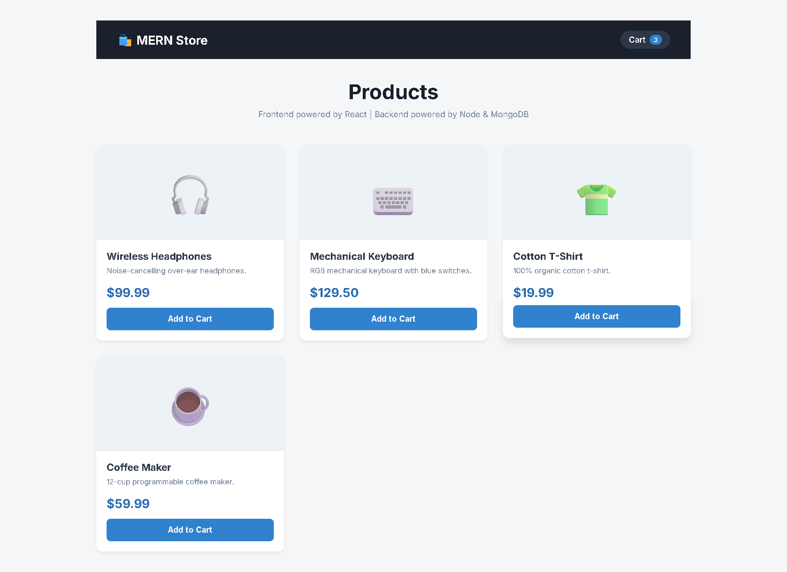
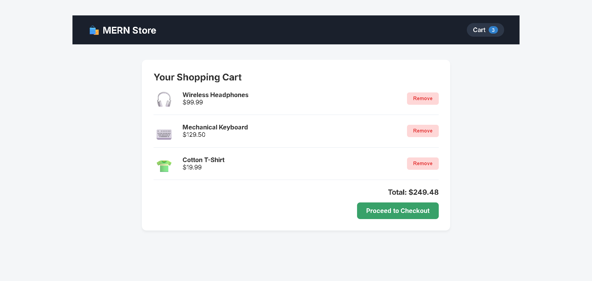
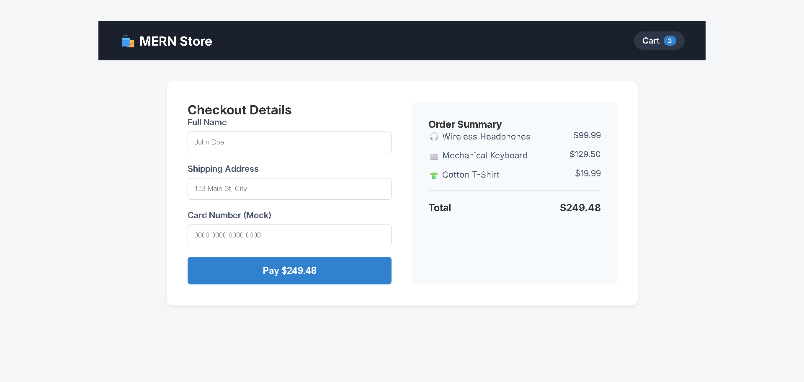
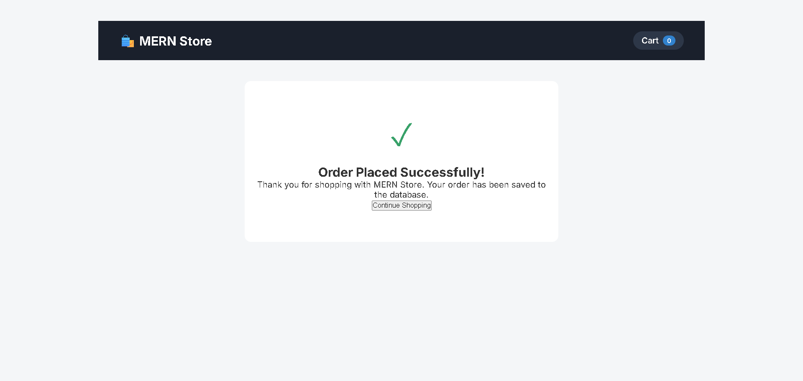

# Full-Stack MERN E-Commerce App


A full-stack MERN e-commerce application. Features a React frontend that fetches products from a Node/Express backend and saves user orders to MongoDB. Demonstrates API integration, global state management, and database persistence.

## 📸 Screenshots

| Storefront | Shopping Cart |
| :---: | :---: |
|  |  |

| Checkout Page | Order Success |
| :---: | :---: |
|  |  |

## 📖 About The Project

This project bridges the gap between frontend and backend development. It features a React frontend that fetches product data from a custom Node.js/Express API and allows users to place orders, which are then saved permanently to a MongoDB database.

It demonstrates a complete data lifecycle: from database seeding, to API serving, to React state management, and back to database persistence.

## ✨ Key Features

*   **Full-Stack Architecture:** Separated `frontend` and `backend` directories for clean code organization.
*   **Complete Shopping Flow:** Browse products, add to cart, view cart, and complete a mock checkout process.
*   **Micro-Interactions:** Custom toast notifications and button state changes to provide instant feedback when items are added to the cart.
*   **REST API:** Custom Node.js/Express API that serves product data and accepts new orders.
*   **React Router:** Seamless navigation between the Shop, Cart, and Checkout pages.
*   **Database Persistence:** Orders placed on the frontend are saved permanently to MongoDB.

## 🛠️ Tech Stack

*   **Frontend:** React, Vite, React Router, CSS3.
*   **Backend:** Node.js, Express.js.
*   **Database:** MongoDB, Mongoose.

## ⚙️ How to Run Locally

Because this is a full-stack application, you must run the backend and frontend in two separate terminals.

### 1. Setup the Backend
```bash
cd backend
npm install
# Create a .env file with MONGO_URI=your_mongodb_connection_string
node seeder.js  # Populate database with initial products
npm run dev     # Starts server on localhost:5000